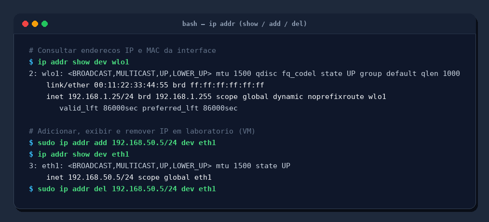
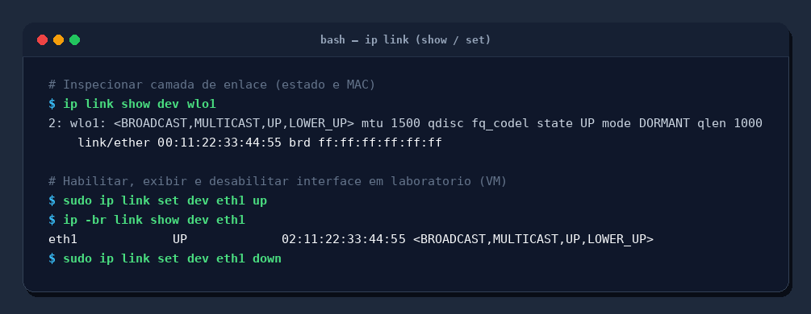
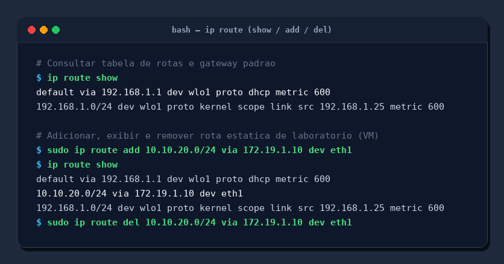
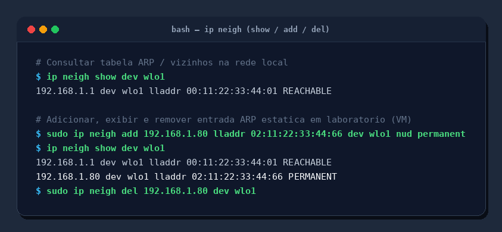
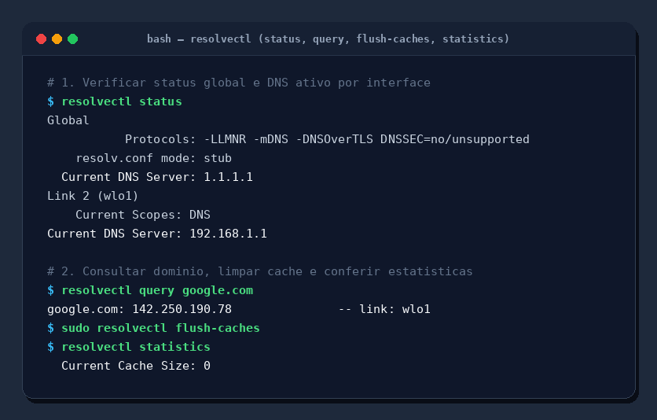
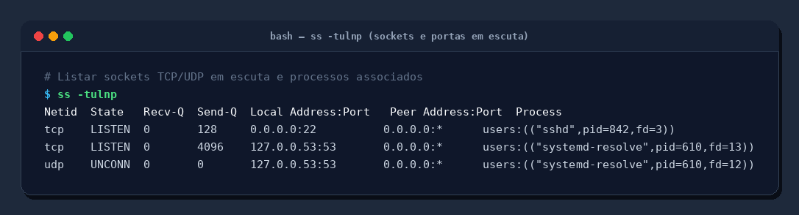

# Diagnóstico e Laboratório de Redes em Bash (`net-audit.sh` & `lab-vm-tests.sh`)

> **Objetivo:** Este repositório reúne atividades práticas de estudo em **Bash/Linux**, com foco na construção de uma base sólida sobre **redes de computadores aplicada à cibersegurança**. A ideia é aprender como uma rede funciona, como consultar suas informações e como realizar testes de maneira controlada, separando comandos que apenas consultam dados daqueles que podem modificar a configuração da rede.

---

## Sobre o Projeto

Este projeto foi desenvolvido para praticar os principais fundamentos de redes no Linux, utilizando ferramentas modernas no lugar de alguns comandos antigos do pacote `net-tools`, como `ifconfig`, `route`, `arp` e `netstat`.

Para isso, são utilizadas ferramentas como `ip`, `resolvectl` e `ss`, que permitem consultar e gerenciar diferentes informações da rede. O projeto também busca aplicar boas práticas de organização e versionamento de código utilizando o Git.

A estrutura é dividida em dois scripts principais:

* **`net-audit.sh` (somente leitura):** responsável por consultar informações da rede, como interfaces, endereços IP, rotas, tabela ARP, configurações DNS e portas abertas. Ele não modifica as configurações da máquina e salva todas as informações coletadas em um relatório `.txt` dentro da pasta `reports/`.

* **`lab-vm-tests.sh` (laboratório / VM):** utilizado para realizar testes práticos que modificam temporariamente a configuração da rede. Ele permite adicionar, alterar e remover configurações, além de consultar os resultados. Após cada teste, o script procura desfazer as alterações realizadas para deixar o ambiente organizado.

---

## Aviso de Segurança (Leitura vs. Laboratório)

Antes de executar os scripts, é importante entender a diferença entre consultar informações e modificar uma rede.

* **Auditoria (`net-audit.sh`):** pode ser utilizado para consultar informações da rede e gerar relatórios locais sem alterar suas configurações. Mesmo assim, os relatórios gerados dentro de `reports/` são ignorados pelo `.gitignore`, evitando que informações pessoais ou detalhes da sua rede, como endereços IP e nomes de computadores, sejam enviados ao GitHub.

* **Laboratório (`lab-vm-tests.sh`):** realiza alterações temporárias em endereços IP, estados das interfaces (`up`/`down`), rotas, entradas ARP e cache DNS. Por trabalhar diretamente com as configurações da rede, **deve ser executado somente em uma máquina virtual (VM) ou em um ambiente isolado**. Evite utilizá-lo na sua máquina principal, pois algumas alterações podem interromper sua conexão com a internet ou afetar o funcionamento da rede.

---

## Estrutura do Repositório

```text
.
├── net-audit.sh          # Script de consulta da rede e geração de relatórios .txt
├── lab-vm-tests.sh            # Script de laboratório para realizar, visualizar e reverter alterações
├── .gitignore             # Ignora relatórios locais, logs, capturas, segredos e arquivos de editor
├── README.md              # Documentação principal do projeto
└── assets/                # Pasta destinada a imagens, exemplos e codesnaps
    ├── codesnap_ip_addr.png
    ├── codesnap_ip_link.png
    ├── codesnap_ip_route.png
    └── codesnap_resolvectl_query_flush.png
```

## Como Usar

1. Primeiro, dê permissão para que os scripts possam ser executados:

   **Bash**
   ```bash
   chmod +x audit_rede.sh lab_rede.sh
   ```

2. Para realizar uma **auditoria segura**, execute o comando abaixo. Ele consulta as informações da rede e gera um relatório `.txt` dentro da pasta `reports/`:

   **Bash**
   ```bash
   ./audit_rede.sh
   ```

3. Para realizar **testes no ambiente de laboratório (VM)**, execute o segundo script. Antes, confira se os nomes das interfaces, como `eth1` ou `wlo1`, e os endereços IP utilizados nos exemplos correspondem ao ambiente de teste:

   **Bash**
   ```bash
   ./lab_rede.sh
   ```

---

## Referência de Comandos e Uso em Cibersegurança

Esta seção apresenta os principais comandos utilizados no projeto, explicando o que cada um faz e por que seu conhecimento é importante para quem está começando na área de cibersegurança.

### 1. `ip addr` (`show`, `add`, `del`)

Permite consultar, adicionar ou remover endereços IP (IPv4/IPv6) das interfaces de rede.

- **O que faz:** o comando `ip -br addr` apresenta um resumo das interfaces, seus estados e endereços IP. Já o `ip addr show` mostra informações mais detalhadas, como máscaras de rede, endereços de broadcast e outros endereços configurados. Os comandos `add` e `del` permitem adicionar ou remover endereços IP, como `192.168.50.5/24`.

- **Por que importa em cibersegurança:** conhecer os endereços IP e as interfaces de uma máquina ajuda a entender a quais redes ela está conectada. Também permite identificar interfaces desconhecidas ou inesperadas, como adaptadores virtuais e túneis de rede, além de facilitar a identificação de possíveis alterações suspeitas.

> **Codesnap (`ip addr`):** 

### 2. `ip link` (`show`, `set`)

Permite consultar e alterar informações das interfaces de rede, como seu estado de funcionamento (`UP`/`DOWN`), endereço MAC e outras características.

- **O que faz:** o comando `ip link show` apresenta as interfaces disponíveis, informa se estão ativas ou inativas e mostra seus endereços MAC (`link/ether`). Já o `ip link set` permite ativar uma interface (`up`), desativá-la (`down`) ou modificar algumas de suas características em um ambiente de teste.

- **Por que importa em cibersegurança:** esse comando ajuda a verificar se as interfaces estão funcionando corretamente, identificar possíveis alterações nos endereços MAC e entender o que acontece quando uma interface é desativada. Isso é útil tanto em auditorias quanto em simulações de problemas de rede.

> **Codesnap (`ip link`):** 

### 3. `ip route` (`show`, `add`, `del`)

Permite visualizar, adicionar ou remover rotas da tabela de roteamento do Linux, incluindo o **gateway padrão** (`default via`), que indica por onde o computador envia o tráfego destinado a outras redes.

- **O que faz:** o comando `ip route show` mostra os caminhos utilizados pelo sistema para enviar dados dentro ou fora da rede local. Os comandos `add` e `del` permitem criar ou remover rotas, incluindo rotas estáticas e rotas padrão utilizadas em testes.

- **Por que importa em cibersegurança:** entender o funcionamento das rotas é importante para verificar se os dados estão sendo enviados pelo caminho correto. Uma rota desconhecida ou inesperada pode indicar uma configuração incorreta ou até uma tentativa de redirecionar o tráfego da máquina para outro destino.

> **Codesnap (`ip route`):** 

### 4. `ip neigh` (`show`, `add`, `del`)

Permite consultar e gerenciar a tabela de vizinhos, também conhecida como tabela **ARP** no IPv4. Essa tabela relaciona os endereços IP aos endereços MAC dos dispositivos encontrados na rede local. É o substituto moderno do antigo comando `arp`.

- **O que faz:** o comando `ip neigh show` apresenta os dispositivos vizinhos identificados na rede local, mostrando seus endereços IP, endereços MAC e estados de comunicação. Já os comandos `add` e `del` permitem adicionar ou remover entradas manualmente para realizar testes, como a criação de uma entrada permanente utilizando `nud permanent`.

- **Por que importa em cibersegurança:** acompanhar a relação entre endereços IP e MAC ajuda a identificar comportamentos inesperados na rede. Por exemplo, se um mesmo endereço IP começar a aparecer associado a diferentes endereços MAC sem uma explicação conhecida, isso pode indicar um conflito de IP ou um possível ataque de **ARP spoofing / ARP poisoning**, no qual um dispositivo tenta se passar por outro dentro da rede local.

> **Documentação / Exemplo (`ip neigh`):** 

### 5. `resolvectl` (`status`, `query`, `flush-caches`, `statistics`)

Permite consultar e controlar informações relacionadas à resolução de nomes DNS, serviço responsável por transformar nomes de domínio, como `google.com`, em endereços IP que os computadores conseguem utilizar para se comunicar.

- **O que faz:**
  - `resolvectl status`: mostra as configurações gerais de DNS e as configurações de cada interface de rede (`Link`). Também apresenta os servidores DNS utilizados, protocolos disponíveis, como DNSSEC e DNS-over-TLS, e informações sobre o funcionamento do arquivo `resolv.conf`.
  - `resolvectl query <dominio>`: realiza uma consulta DNS para verificar qual endereço IP está associado a determinado domínio e qual interface foi utilizada na consulta.
  - `resolvectl flush-caches`: limpa o cache DNS armazenado localmente pelo sistema. Esse comando pode ser utilizado em laboratório para testar novamente a resolução de nomes sem aproveitar as informações armazenadas anteriormente.
  - `resolvectl statistics`: apresenta informações estatísticas sobre o funcionamento do DNS, incluindo dados do cache, como quantidade de entradas, acertos (*hits*), erros de consulta ao cache (*misses*) e número de consultas realizadas.

- **Por que importa em cibersegurança:** entender o funcionamento do DNS ajuda a identificar servidores DNS desconhecidos ou suspeitos, verificar se um domínio está apontando para o endereço IP esperado e investigar possíveis alterações na resolução de nomes. Também permite compreender como o cache DNS influencia as consultas realizadas pelo computador.

> **Codesnap (`resolvectl`):** 

### 6. `ss -tulnp`

Permite listar as conexões e portas de rede em escuta (`TCP` e `UDP`) no computador, mostrando os números das portas e, quando disponível, os processos responsáveis por utilizá-las. É a alternativa moderna ao antigo comando `netstat`.

- **O que faz:** apresenta quais serviços estão aguardando conexões na máquina, em quais portas estão funcionando e quais endereços estão sendo utilizados. As opções `-t`, `-u`, `-l`, `-n` e `-p` permitem filtrar as informações para visualizar conexões TCP, UDP, portas em escuta, números de portas sem conversão para nomes de serviços e processos associados, respectivamente.

- **Por que importa em cibersegurança:** esse é um comando muito importante para a **auditoria da superfície de ataque**. Ele ajuda a identificar portas abertas desnecessariamente, serviços que não deveriam estar funcionando e processos desconhecidos aguardando conexões. Quanto mais serviços expostos sem necessidade, maior pode ser a quantidade de possíveis pontos de entrada para um invasor.

> **Documentação / Codesnap (`ss -tulnp`):** 

